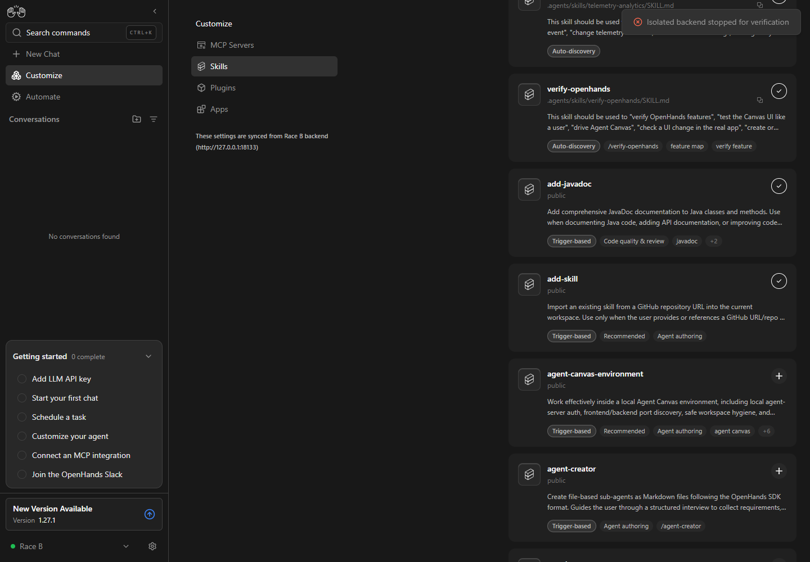

# PR #17970: backend-switch rollback review

This report was generated by an AI agent on behalf of the requester.

- Before: `8a13bda59017f0bf8bd1c4509e2191336e65de3a`.
- After: `9614a0d3becd339bcd9f065716ceb216b6324b7e`.
- Windows, Node 24.19.0, Playwright 1.63.0 with Microsoft Edge, 1440×1000 viewport.
- Two real `openhands-agent-server==1.53.0` processes with separate persistence directories.
- No LLM execution or credentials. Production frontend builds, MSW disabled.
- Captured on 2026-10-13. The helper retains private state locally; private state is not published.

## Observed result

| Run | B's changed skill | B's untouched skill | Terminal save-error toast |
| --- | --- | --- | --- |
| Before | disabled (incorrect) | disabled (incorrect) | present |
| After | enabled (restored) | enabled (preserved) | present |

[Before video](before.webm) · [After video](after.webm)




The original user bug's earlier recordings remain linked in the PR description. These recordings address enyst's new backend-switch race specifically.

## Reproduction

The tracked [reproduce.cjs](reproduce.cjs) launches and shuts down only its own child processes. The repository's control-openhands lifecycle uses POSIX process groups, so this Windows run uses the attached helper with direct child handles instead of claiming a control-openhands doctor pass.

Prepare sibling checkouts `work/oh17970-before` at the before commit and `work/oh17970` at the after commit. Run `npm ci` and `npm run build` in each (with Node >=24). Create `work/oh17970-python` with Python 3.12 and install `openhands-agent-server==1.53.0` and `posthog>=6,<7`. Install Playwright's ffmpeg and Microsoft Edge. Save the helper as `work/oh17970-live.cjs`, then run from the parent of `work`:

```powershell
node work/oh17970-live.cjs before
node work/oh17970-live.cjs after
```

When Playwright browsers live outside the default directory, set `PLAYWRIGHT_BROWSERS_PATH` to that directory. The run uses loopback ports 18130–18133 and 31630 and writes under `outputs/oh17970-backend-switch`.

1. Seed A with add-skill enabled and B with add-skill + add-javadoc enabled, through their real settings APIs.
2. Disable add-skill on A in the actual Skills UI. A commits the PATCH; the loopback proxy holds its actual successful response.
3. Switch to B through the real backend selector and wait for both toggles to show enabled.
4. Release A's PATCH response. Hold B's actual GET settings refetch response.
5. Verify A's committed list is empty and B's persisted list still contains both skills, using the real servers.
6. Stop only B's isolated server. Disable add-skill on B.
7. Wait for the terminal save-error toast emitted by the real hook; capture the final state while B's GET remains held.
8. Release held responses, stop the remaining owned processes, and verify all five ports are closed.

The proxy forwards actual response bodies; it does not manufacture successful settings reads or writes. A 502 is produced only when B's real server is unavailable. No durable incorrect backend write is claimed: the demonstrated defect is the frontend rollback baseline.

## Code and tests

The write dispatch captures backend ID, organization ID, and an owner generation. The mutation stores that context together with the original persisted callback, so replacing mutation options cannot relabel a pending write. An obsolete completion cannot advance the current rollback baseline. Owner generations also reject A → B → A completions. Same-owner successful writes still advance the baseline before awaiting GET.

The new integration suite uses the real ActiveBackendProvider, useSettings, useSaveSettings, and useSkillEnablement, with controlled SettingsService timing:
- A pending-response control passes on the old code.
- Backend switch, Cloud organization switch, and cached-owner roundtrip cases fail on the old code.
- All four cases pass on the fix, including the untouched-skill assertion.

Final focused suite: 6 files / 38 tests passed. Lint, application build and library build passed; lint reports 528 existing warnings and no errors. See [focused log](focused.log), [lint log](lint.log), [build log](build.log), and [library build log](build-lib.log).

The full run during implementation reported 8492 passed, 16 failed, 33 skipped and 7 todo. It preceded the final separation of owner generation from hydration version; the final focused suite and builds above cover that refinement. All 16 failures also reproduce on the original PR head with the same committed dependencies and Windows environment. They concern Windows paths, symlinks, shell scripts/platform defaults, and existing verification helpers, rather than these hook changes. See [full log](full.log), [original-head failing suites](baseline-failures.log), and [negative control](negative-control.log).

Cloud organization switching is covered through real hooks/context with the service controlled, not a live Cloud account. The live evidence covers two Local backends. Settings behavior is shared by standalone and embedded Canvas and is independent of conversation agent/planning/delegation mode.

## Teardown

All owned backend/frontend processes and proxy listeners were stopped. Ports 18130, 18131, 18132, 18133 and 31630 were checked closed. Recordings and screenshots were retained and inspected. No private state, browser profile or session keys are included.
